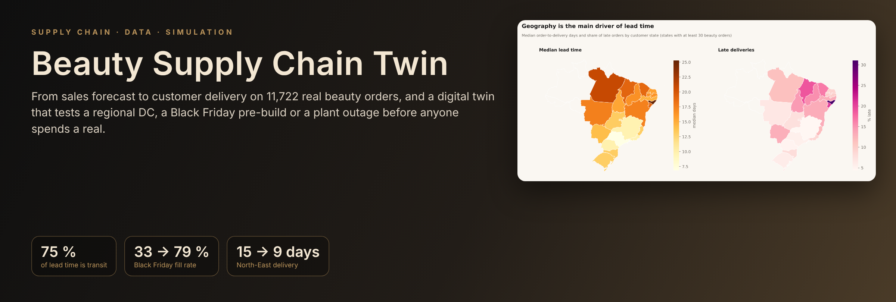
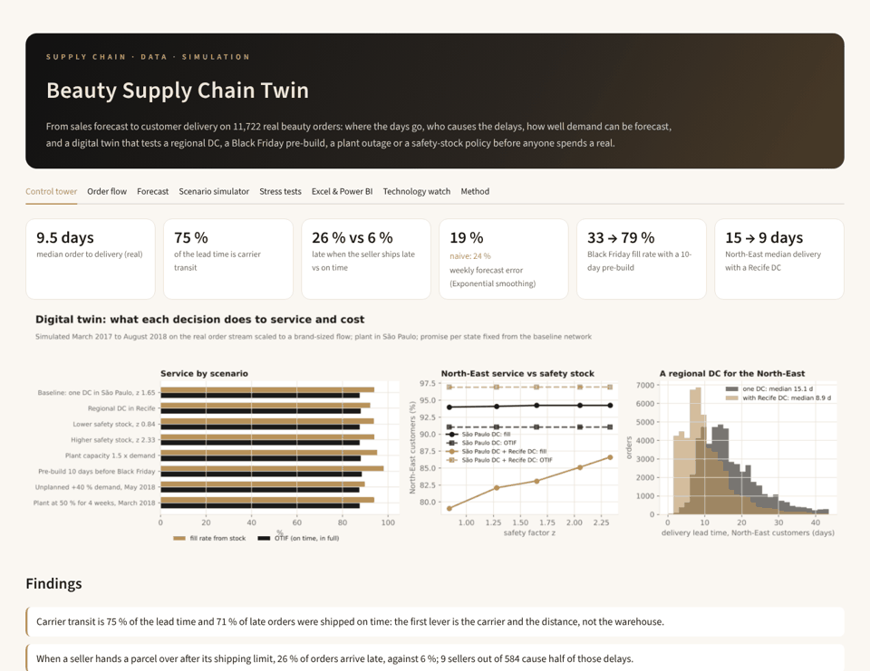
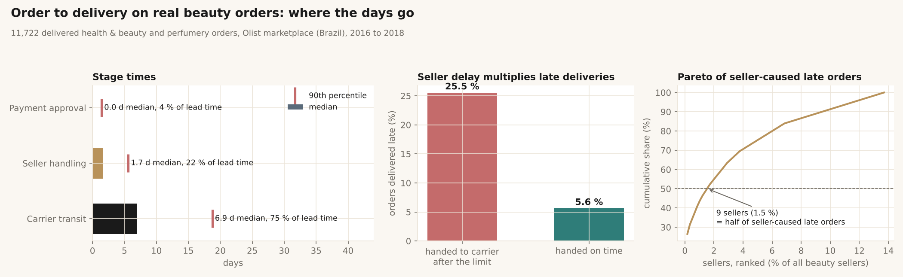
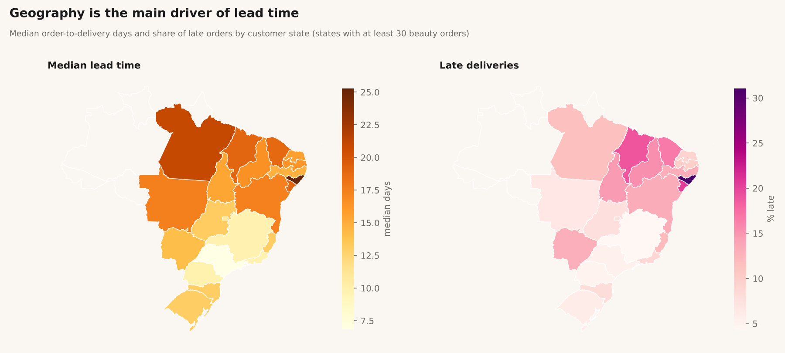
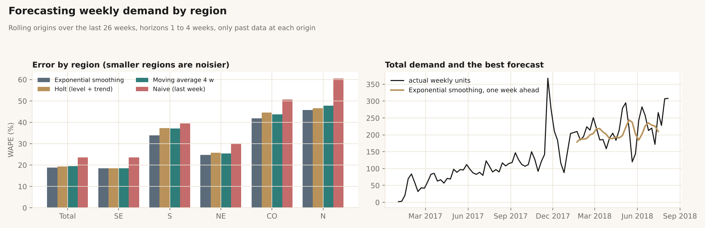
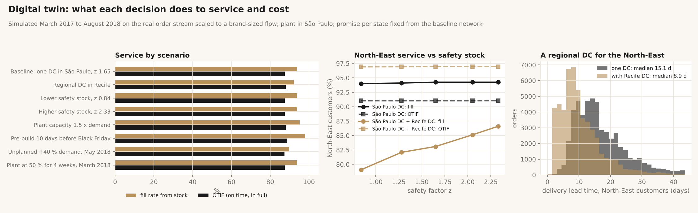
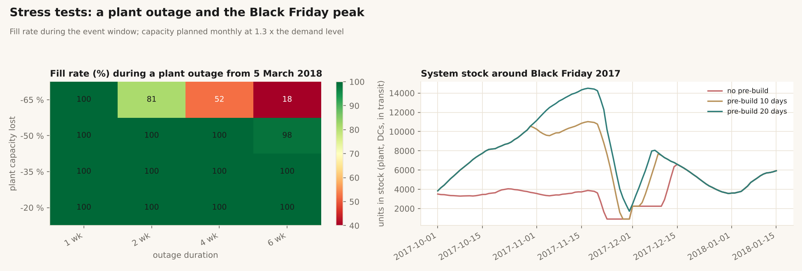
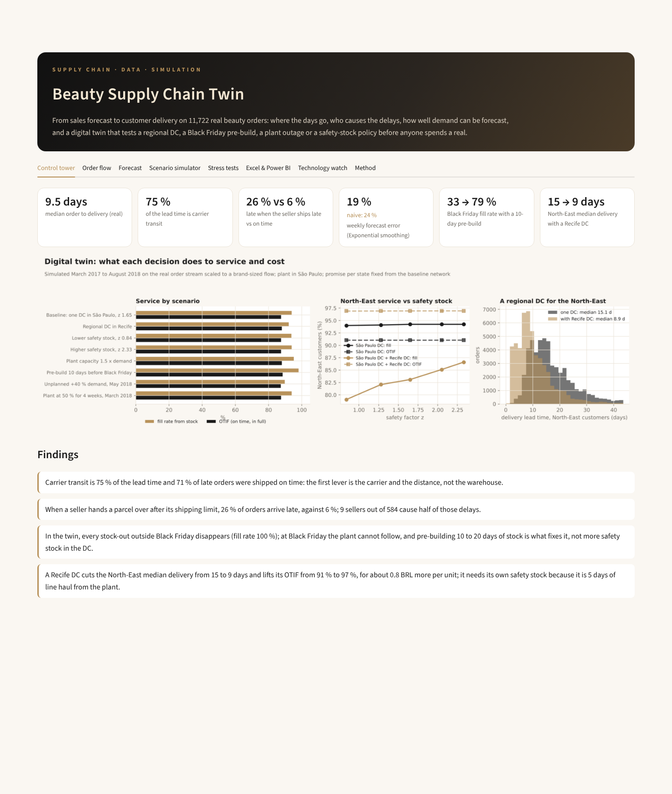
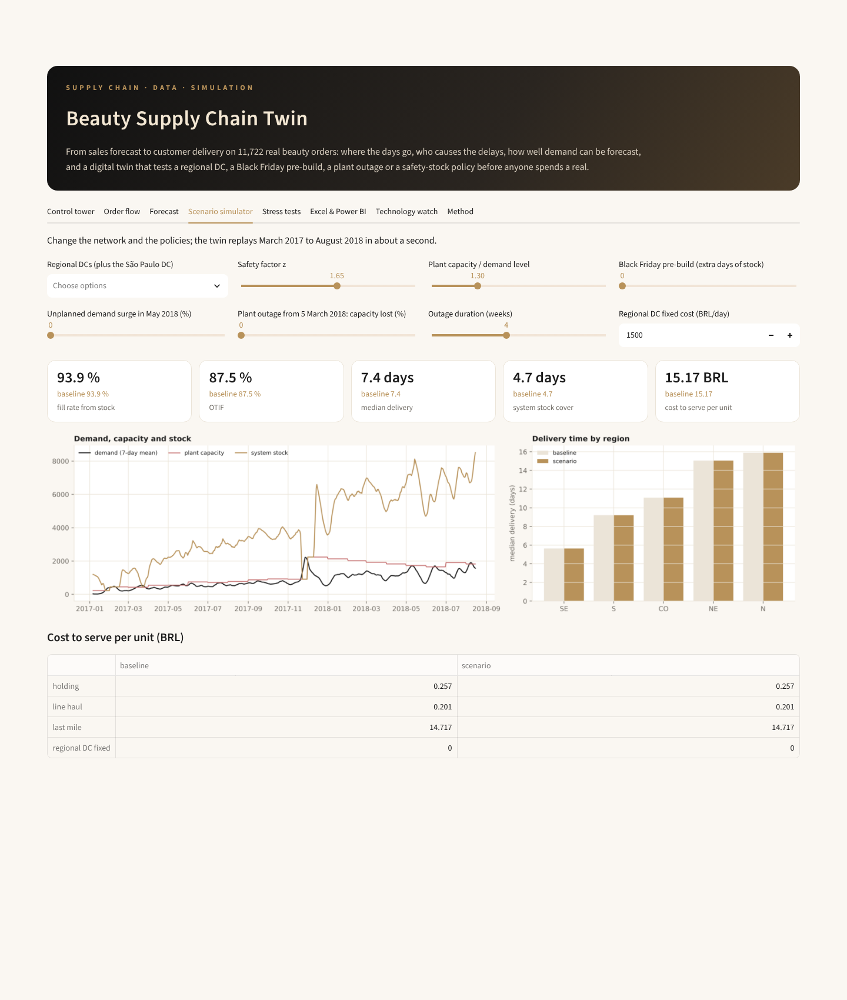

<p align="center"></p>

<p align="center">
  <a href="https://github.com/kawtar-bellamine/beauty-supply-chain-twin/actions/workflows/tests.yml"></a>
  
  
  
  
</p>

**From sales forecast to customer delivery, on 11,722 real beauty orders.** The project measures where the days go
between an order and its delivery, finds who and what causes late deliveries, compares forecasting methods, and builds
a **digital twin** of a plant, its distribution centres and its customers to test decisions before making them: a
regional DC, a Black Friday pre-build, a plant outage, a safety-stock policy. It ends with an **Excel model with live
formulas** and a **Power BI-ready star schema**.

<p align="center"></p>

## Results at a glance

| Question | Answer |
|---|---|
| Where do the days go? | Median order to delivery **9.5 days**; carrier transit is **75 %** of the lead time, seller handling 22 %, payment 4 %. |
| Who causes late deliveries? | **71 %** of late orders were shipped on time: the carrier and the distance. When a seller ships after its limit, **26 %** of orders arrive late against 6 %, and **9 sellers out of 584** cause half of those delays. |
| Where is service worst? | The North-East: 17 days median, **15 % late**, twice the freight of the South-East. |
| How well can demand be forecast? | Exponential smoothing: **19 %** weekly error at country level against 24 % for last week's figure; 25 to 46 % by smaller region. |
| What breaks the network? | In the twin, every stock-out outside Black Friday disappears (fill rate 100 %); at Black Friday the plant cannot follow (**33 %** fill). A **10-day pre-build** lifts it to **79 %**, 20 days to **100 %**. More safety stock in the DC changes nothing: the constraint is upstream. |
| Would a North-East DC pay? | A Recife DC cuts the North-East median delivery from **15 to 9 days** and lifts its OTIF from 91 % to **97 %**, for **+0.83 BRL per unit (+5.5 %)**; it needs its own safety stock, being 5 days of line haul from the plant (fill 79 % at z 0.84, 87 % at z 2.33). |
| How resilient is the plant? | 4.7 days of system stock absorb a 50 % capacity loss for 4 weeks; at -65 %, fill falls to 81 % after 2 weeks, 52 % after 4, 18 % after 6. |

## 1. The real order-to-delivery flow



`bsc/flow.py`, `sql/`. Every delivered order is split into payment approval, seller handling and carrier transit. A late
order (after the end of its promised day) is attributed to the seller when it was handed to the carrier after the
shipping limit, to the carrier otherwise.



| Region | Orders | Median lead time | 90th percentile | Late | Median distance | Freight per order |
|---|---:|---:|---:|---:|---:|---:|
| South-East | 7,951 (68 %) | 7.8 d | 18.2 d | 6.0 % | 311 km | 16.7 BRL |
| South | 1,430 | 11.7 d | 24.2 d | 6.2 % | 686 km | 21.0 BRL |
| North-East | 1,330 | 17.2 d | 34.7 d | **15.1 %** | 1,923 km | 33.1 BRL |
| Centre-West | 767 | 13.0 d | 25.2 d | 8.0 % | 883 km | 23.0 BRL |
| North | 244 | 19.5 d | 37.6 d | 10.2 % | 2,421 km | 37.6 BRL |

## 2. Forecasting



`bsc/forecast.py`. Weekly units by region, four methods on 26 rolling origins (horizons 1 to 4 weeks, only past data
at each origin). Exponential smoothing wins in total (WAPE 18.8 %, bias -4.7 %); Holt has almost no bias (+0.3 %) for a
slightly higher error.

## 3. The digital twin



`bsc/twin.py`, `bsc/leadtime.py`. A plant near São Paulo, one or more DCs, and the customers of the real orders.

* **Demand:** the real daily order rate × 40 (a brand-sized flow, about 450,000 orders), Poisson at that scale, each
  order copying a real one of the same fortnight (location, state, units).
* **Transit:** drawn from the **96,000 real deliveries** in the same distance band; last-mile cost from the median
  real freight per beauty item in that band.
* **Policy:** each DC reviews daily with an order-up-to level `S = f (L + R) + z σ √(L + R)`, forecast and error
  updated online; plant capacity planned monthly at 1.3 × the demand level.
* **Promise:** per state, fixed from the baseline network for every scenario, so OTIF is comparable.

| Scenario | Fill rate | OTIF | Median delivery | Stock cover | Cost per unit |
|---|---:|---:|---:|---:|---:|
| Baseline: one DC in São Paulo, z 1.65 | 93.9 % | 87.5 % | 7.4 d | 4.7 d | 15.18 BRL |
| Regional DC in Recife | 92.1 % | 88.0 % | 7.1 d | 5.2 d | 16.01 BRL |
| Lower safety stock, z 0.84 | 93.7 % | 87.5 % | 7.4 d | 4.6 d | 15.17 BRL |
| Higher safety stock, z 2.33 | 93.9 % | 87.5 % | 7.4 d | 4.8 d | 15.18 BRL |
| Plant capacity 1.5 × demand | 95.3 % | 88.0 % | 7.3 d | 4.9 d | 15.19 BRL |
| **Pre-build 10 days before Black Friday** | **98.1 %** | **88.4 %** | 7.2 d | 5.3 d | 15.21 BRL |
| Unplanned +40 % demand in May 2018 | 89.7 % | 87.4 % | 7.5 d | 4.5 d | 15.13 BRL |
| Plant at 50 % for 4 weeks, March 2018 | 93.9 % | 87.5 % | 7.4 d | 4.6 d | 15.17 BRL |

OTIF stays near 88 % in every scenario of the central network because the late orders come from the carrier tail, as
in the real data: stock decisions move the fill rate, only the network moves OTIF.



## 4. Excel and Power BI

* `exports/inventory_policy_model.xlsx`: the same order-up-to policy in **Excel formulas** (NORMSINV, ROUNDUP, SQRT).
  Change the blue inputs (service level, demand growth, unit value, holding rate, truck speed) and safety stock, order-up-to
  levels, days of cover and holding cost recalculate; a service-level sheet with its chart shows what each extra point
  of service costs. 47 formulas, 0 errors after recalculation.
* `exports/*.csv`: a **star schema for Power BI**: `fact_beauty_orders` (every stage time), `dim_state`, `dim_date`,
  `fact_twin_daily_baseline`, `fact_twin_scenarios`.

## 5. Technology watch

[`docs/tech_watch.md`](docs/tech_watch.md) maps machine learning forecasting, digital twins, IoT tracking, RFID,
warehouse robotics, control towers and blockchain traceability to the findings above, each with the KPI a pilot would
have to move.

## Interactive control tower

```bash
pip install -r requirements.txt
python experiments/run_all.py     # downloads the data (120 MB, checksummed), runs the study in about 30 s
streamlit run app/dashboard.py    # dashboard
pytest -q                         # 11 tests on a committed sample of the real data
```

The **Scenario simulator** tab replays March 2017 to August 2018 in about a second with your network (add Recife,
Brasília or Curitiba DCs), safety factor, plant capacity, Black Friday pre-build, demand surge and plant outage, and
compares fill rate, OTIF, delivery time by region and cost to serve with the baseline.

<table>
<tr><td width="50%"></td>
<td width="50%"></td></tr>
</table>

## Repository map

```
sql/                 staging and marts in DuckDB SQL (stage times, distances, daily demand)
bsc/data.py          download with checksums, warehouse build
bsc/flow.py          stage times, late causes, regions, seller Pareto
bsc/forecast.py      weekly forecasting and rolling backtest
bsc/leadtime.py      transit-time and freight models learnt from real deliveries
bsc/twin.py          plant, DCs and customers: inventory policy, capacity, scenarios
bsc/excel_model.py   Excel model with live formulas
experiments/         full study, figures, exports
app/dashboard.py     Streamlit control tower and simulator
docs/                method, limits, technology watch
```

## Limits

* The data is a Brazilian marketplace, not a brand's own network: the twin borrows its demand pattern, geography and
  transit times, with a hypothetical plant and DCs.
* Volumes are scaled ×40; costs (unit value, holding rate, line haul, DC fixed cost) are assumptions written in one
  place and editable in the Excel model and the simulator.
* One product family, a single plant capacity, no production changeovers.

## Data and licence

Data: [olist/work-at-olist-data](https://github.com/olist/work-at-olist-data), MIT licence (c) 2019 Olist. Map: simplified
from [click_that_hood](https://github.com/codeforamerica/click_that_hood), MIT licence (c) Code for America, from IBGE
data. Code: MIT.
